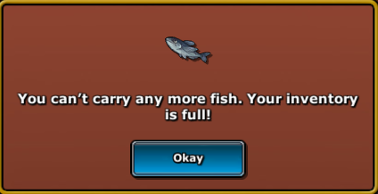
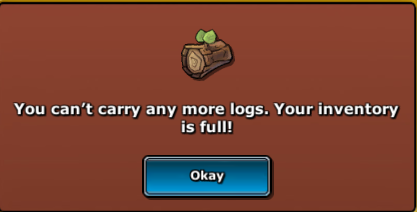
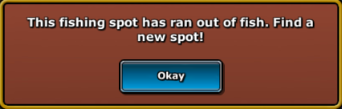
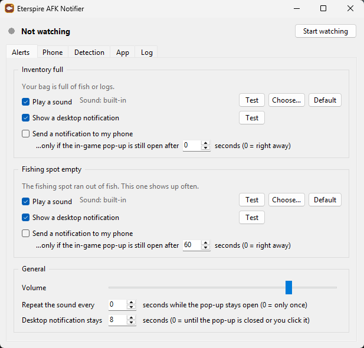
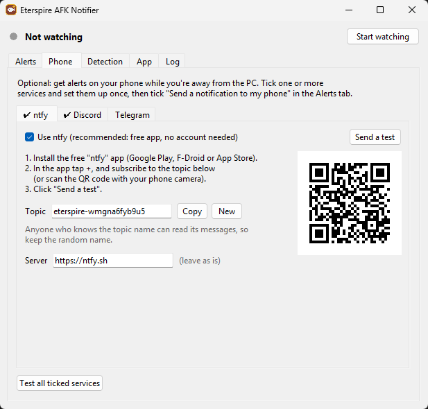
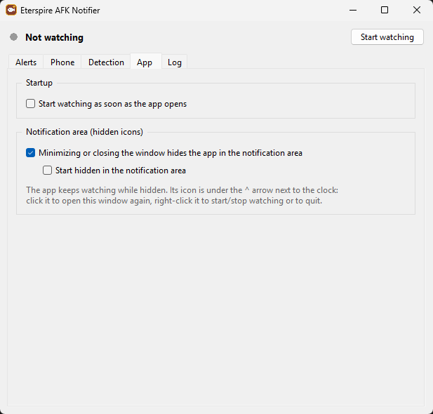

# Eterspire AFK Notifier

Fishing and woodcutting in **Eterspire** keep going while you're AFK, until the game needs you.
This small Windows app watches the game and tells you when that happens:

| Pop-up in the game | What you get |
| --- | --- |
|   | **Inventory full**: a sound and a small desktop notification, plus a phone notification if you turn it on. |
|  | **Fishing spot empty**: a sound and a desktop notification. Phone notifications for this one have their own switch and, by default, only go out if you haven't closed the pop-up within 60 seconds, so your phone doesn't buzz every few minutes. |



## Getting started

**Option A: the .exe (easiest).** Download `EterspireNotifier.exe` from the
[Releases](../../releases) page and double-click it. Nothing to install.

> Windows SmartScreen may warn about an unknown app the first time; click *More info → Run anyway*.

**Option B: from the source code.** Install [Python 3.10+](https://www.python.org/downloads/)
(tick *Add python.exe to PATH*), then double-click `run.bat`. The first start takes a minute to
install what it needs.

Then just play: start fishing or woodcutting, and leave the app open. It starts watching right
away (you can turn that off). The game can be behind other windows or on another monitor, it
only must not be minimized.

## Phone notifications (optional)

Nothing to set up if you don't want them: they're off until you tick
**Send a notification to my phone** for an alert. To use them, tick one or more services in the
**Phone** tab (each service has its own sub-tab with a **Use …** box and a **Send a test** button).
Every ticked service gets every phone notification, so you can, for example, get them both in
the ntfy app and in a Discord channel:



- **ntfy (recommended, free, no account)**
  1. Install the [ntfy app](https://ntfy.sh/) on your phone (Google Play, F-Droid or App Store).
  2. Tap **+** and subscribe to the topic shown in the app, or scan the QR code with your phone camera.
     The topic is a random name made just for you; anyone who knows it can read your
     notifications, so don't share it.
  3. Click **Send a test**.
- **Discord**: create a webhook in your own server (*Server Settings → Integrations → Webhooks →
  New Webhook → Copy Webhook URL*), paste it, and make sure that channel's notifications are on
  in the Discord phone app.
- **Telegram**: create a bot with [@BotFather](https://t.me/BotFather) (`/newbot`), paste its
  token, send your bot any message, then click **Find my chat ID**.

Then, in the **Alerts** tab, tick **Send a notification to my phone** for the alerts you want.
Each alert has its own delay: *"only if the in-game pop-up is still open after N seconds"*.
`0` sends right away. If you close the pop-up before the delay is over, nothing is sent.

## All the options

| Setting | Where | Default |
| --- | --- | --- |
| Sound on/off, custom `.wav` sound, test button | Alerts, per alert | on, built-in chime |
| Desktop notification on/off | Alerts, per alert | on |
| Phone notification on/off | Alerts, per alert | off |
| Which phone services to use (any combination) | Phone | ntfy |
| Phone delay (only if the pop-up is still open after N s) | Alerts, per alert | 0 s inventory, 60 s fishing spot |
| Volume | Alerts → General | 80 |
| Repeat the sound every N s while the pop-up stays open | Alerts → General | off |
| How long the desktop notification stays | Alerts → General | 8 s |
| Game window title, or watch all screens | Detection | `Eterspire` |
| How often to check | Detection | every 1 s |
| Strictness of the match | Detection | 0.70 |
| Start watching when the app opens | App | on |
| Minimizing or closing hides the app in the notification area | App | off |
| Start hidden in the notification area | App | off |

Settings are saved automatically in `%APPDATA%\EterspireNotifier\config.json`.

The desktop notification shows in the bottom-right corner without taking the keyboard focus
away from the game; click it to dismiss it. It also disappears by itself when you close the
pop-up in the game.

### Hiding in the notification area

In the **App** tab, tick **Minimizing or closing the window hides the app in the notification
area**. The app then keeps watching from the taskbar's hidden icons (the **^** arrow next to the
clock): click its icon to open the window, right-click it to start/stop watching or to quit. With
**Start hidden in the notification area** it opens straight there.



## Troubleshooting

- **A pop-up isn't detected.** Open it in the game, go to **Detection** and click
  **Test detection now**. Each pop-up gets a score; anything above the strictness counts as found.
  If the score is just below, lower the strictness a little.
- **The status says "Watching all screens: no window called Eterspire found".** Check the game
  window's title in the taskbar and type it in **Detection → Only watch the game window**.
  When watching all screens, the game has to be visible (not covered).
- **The game updated and the pop-ups look different.** Take a screenshot of the new pop-up, crop
  its first line of text, and save it as `inventory_full_fish.png`, `inventory_full_logs.png` or
  `spot_empty.png` in the folder opened by **Open custom templates folder**, then click
  **Reload templates**. Yours replace the built-in ones. Compare with the files in
  [`eterspire_notifier/templates`](eterspire_notifier/templates) to see how to crop.

## How it works

Every second the app takes a picture of the game window (with Windows' `PrintWindow`, which works
when the game is covered by other windows) and looks for the pop-ups in two steps:

1. **Find pop-up shaped panels.** All of the game's pop-ups share the same flat red-brown panel.
   Pixels of that colour are grouped into blobs, and blobs with a pop-up's shape are kept. The
   panel's width also tells how big the game draws its pop-ups, whatever the window size.
2. **Read the text.** Inside each panel, the first line of text of each known pop-up
   ([`templates/`](eterspire_notifier/templates)) is compared at that size with OpenCV template
   matching. The best match above the strictness setting says which pop-up is open.

A scan takes about 10 ms on a 1080p window, and the result for a pop-up that stays open is
reused, so the app uses almost no CPU while you're away.

Each pop-up is tracked over time ([`tracker.py`](eterspire_notifier/tracker.py)): the alert fires
once when it appears, the phone delay counts from that moment, and the pop-up only counts as
closed after it's been gone for two checks in a row.

The app only reads pixels from the screen. It never sends input to the game or touches its files.

## Development

```bash
python -m venv .venv
.venv\Scripts\python -m pip install -r requirements.txt pytest
.venv\Scripts\python -m pytest
.venv\Scripts\python run.py
```

| File | What it does |
| --- | --- |
| `eterspire_notifier/app.py` | Settings window, wiring between monitor and alerts |
| `eterspire_notifier/monitor.py` | Background thread: capture → detect → track |
| `eterspire_notifier/capture.py` | Finds the game window and captures it |
| `eterspire_notifier/detector.py` | Pop-up detection (panel colour + text templates) |
| `eterspire_notifier/tracker.py` | Pop-up open/closed state, phone delay, sound repeats |
| `eterspire_notifier/alerts.py` | Sounds, ntfy / Discord / Telegram |
| `eterspire_notifier/overlay.py` | Desktop notification that doesn't steal focus |
| `eterspire_notifier/tray.py` | Notification-area icon |
| `tools/make_sounds.py`, `tools/make_icon.py` | Generate the built-in sounds and the app icon |

`build.bat` builds `dist\EterspireNotifier.exe` with PyInstaller. Pushing a `v*` tag to GitHub
runs the tests, builds the exe and attaches it to the release
([`.github/workflows/build.yml`](.github/workflows/build.yml)).

Eterspire AFK Notifier is a fan-made tool and is not affiliated with the developers of Eterspire.
